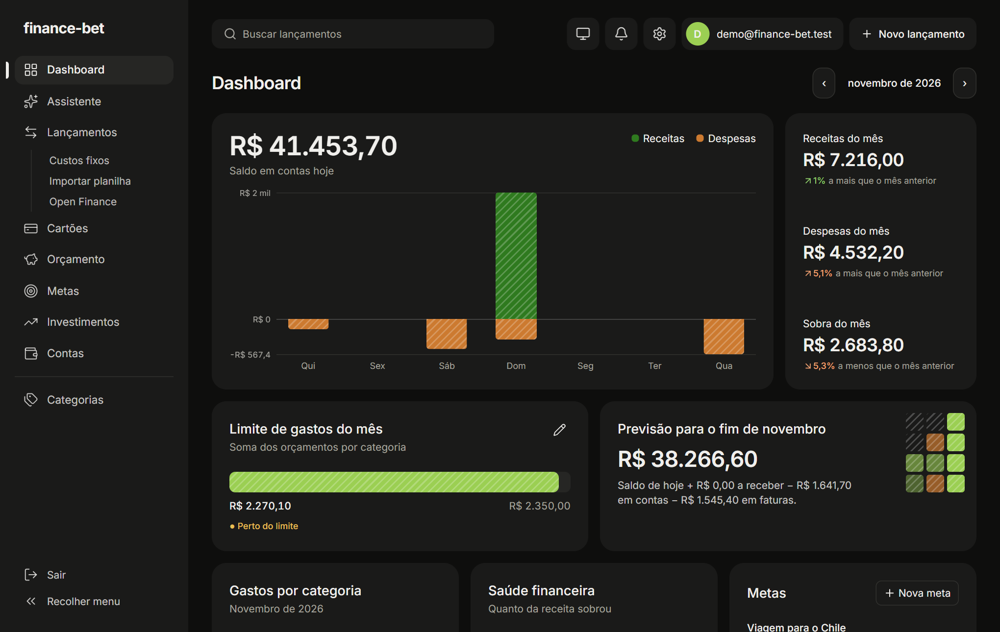
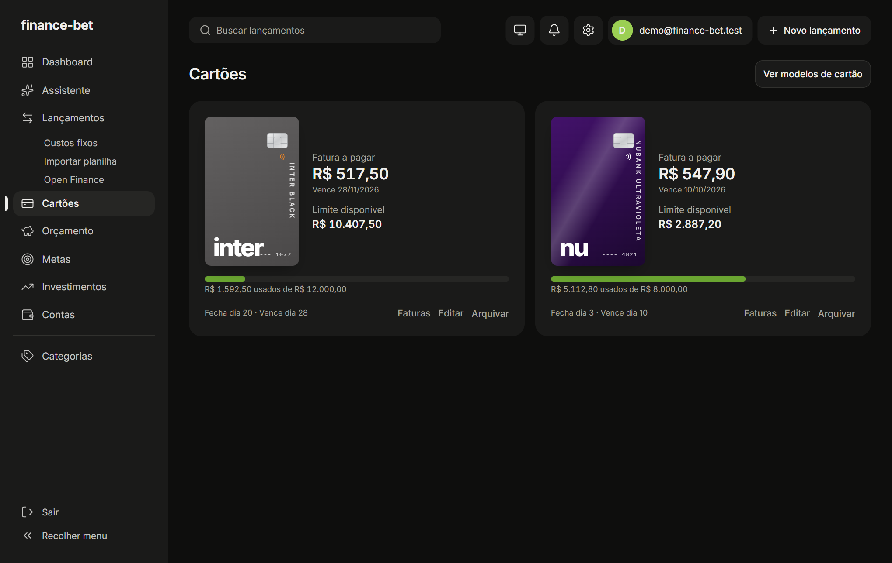
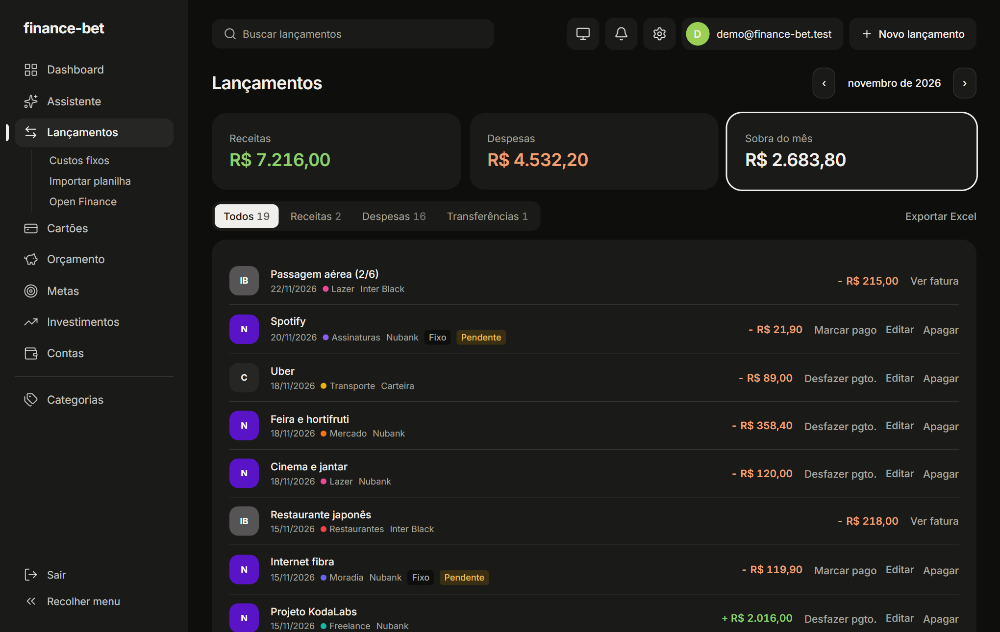
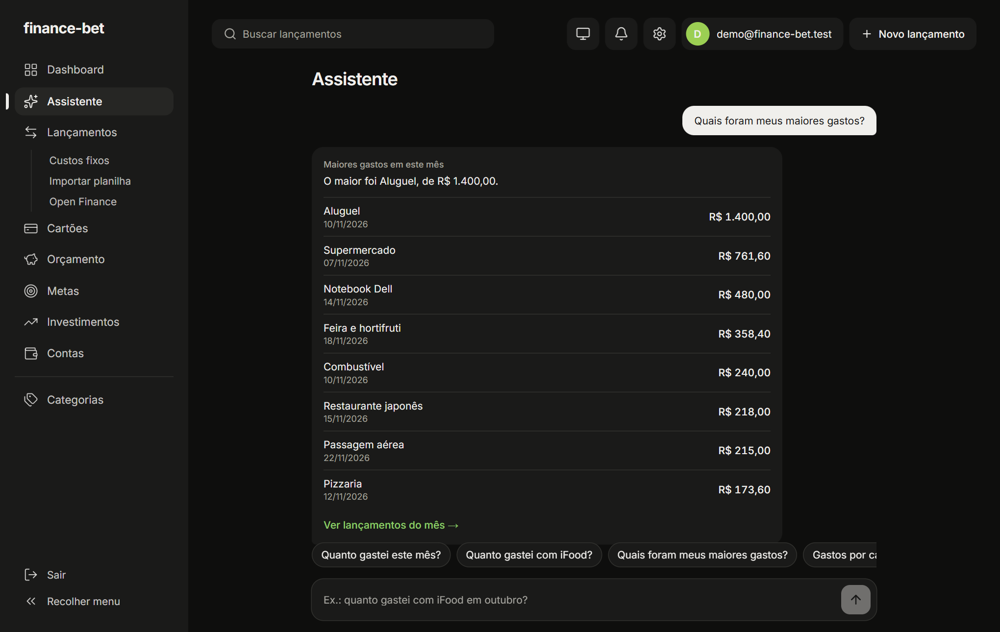
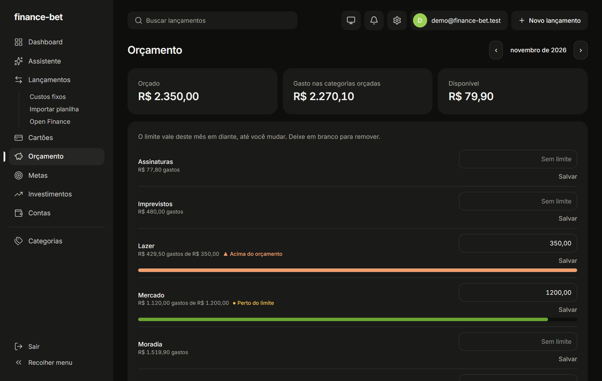
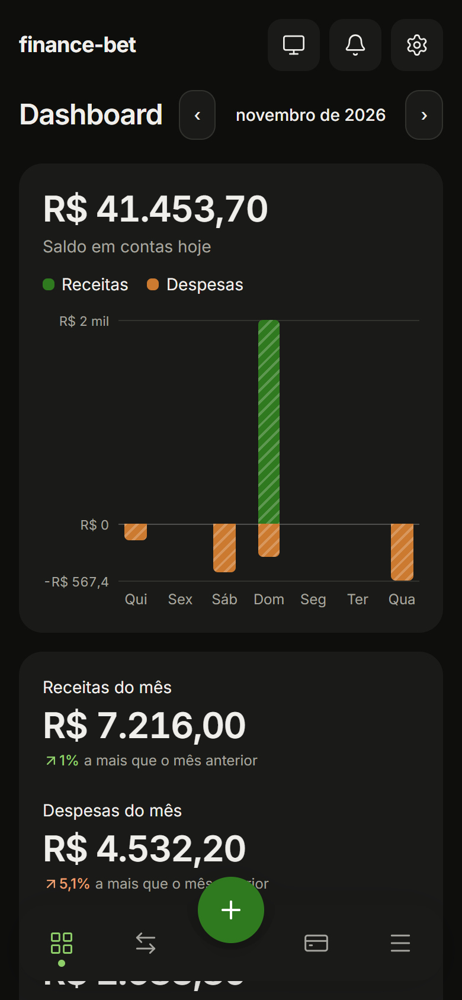

<div align="center">

# 💸 finance-bet

**Controle financeiro pessoal completo: contas, cartões, faturas, metas e Open Finance em um só lugar.**

[](https://nextjs.org)
[](https://react.dev)
[](https://www.typescriptlang.org)
[](https://supabase.com)
[](https://tailwindcss.com)
[](https://finance-bet-amber.vercel.app)

[**🌐 Ver online**](https://finance-bet-amber.vercel.app) · [Especificação](docs/especificacao-mvp.md)

<br>



<sub>Telas com dados de exemplo (fictícios)</sub>

</div>

---

## ✨ Sobre

O **finance-bet** é um app web para organizar a vida financeira de verdade, não só anotar gastos. Ele entende como cartão de crédito funciona (fechamento, vencimento, parcelas, fatura paga), gera os custos fixos sozinho todo mês e puxa as transações do banco em tempo real via **Open Finance**.

É responsivo e instalável no celular (PWA), para lançar um gasto na hora em que ele acontece.

## 🚀 Funcionalidades

| | |
|---|---|
| 📊 **Dashboard** | Receitas x despesas do mês, gráfico de evolução, medidor de orçamento e patrimônio líquido |
| 🏦 **Open Finance** | Conecta o banco via Pluggy e traz as transações em tempo real para uma área de revisão. Nada vira lançamento sem você confirmar |
| 💳 **Cartões e faturas** | Fechamento e vencimento por cartão, compras parceladas (cada parcela na fatura certa), pagamento e estorno de fatura |
| 🔁 **Custos fixos** | Regras recorrentes que geram os lançamentos do mês sem duplicar, inclusive dos meses em que o app não foi aberto |
| 📥 **Importar planilha** | `.xlsx` ou `.csv` com prévia editável, sugestão de categoria, alerta de duplicados e desfazer o lote inteiro |
| 🎯 **Orçamento e metas** | Limite por categoria com alerta, metas com prazo vinculadas a uma conta |
| 📈 **Investimentos** | Aportes como transferência para conta de investimento (não contam como gasto) |
| 🤖 **Assistente** | Pergunte em português: *"quanto gastei com mercado em outubro?"*, *"quais minhas maiores despesas?"*, *"vou fechar o mês no azul?"* |
| 📧 **Avisos por e-mail** | Notificação de entrada de dinheiro (Resend) e resumo mensal automático no dia 1º |
| 📤 **Exportar** | Exporta os lançamentos para Excel |
| 🌗 **Tema claro e escuro** | E instalação como app no celular |

## 📸 Telas

<table>
  <tr>
    <td width="50%"></td>
    <td width="50%"></td>
  </tr>
  <tr>
    <td align="center"><sub>Cartões, faturas e limite disponível</sub></td>
    <td align="center"><sub>Lançamentos do mês, com custos fixos e parcelas</sub></td>
  </tr>
  <tr>
    <td width="50%"></td>
    <td width="50%"></td>
  </tr>
  <tr>
    <td align="center"><sub>Assistente que responde perguntas em português</sub></td>
    <td align="center"><sub>Orçamento por categoria com alertas</sub></td>
  </tr>
</table>

<p align="center">
  
  <br><sub>Feito para usar no celular</sub>
</p>

## 🛠️ Stack

- **Front e back:** Next.js 16 (App Router, Server Actions), React 19, TypeScript
- **Estilo:** Tailwind CSS 4, ícones Lucide
- **Banco e login:** Supabase (Postgres + Auth + RLS), com 13 migrations versionadas
- **Open Finance:** Pluggy SDK + widget Pluggy Connect, com webhook assinado
- **E-mail:** Resend
- **Deploy:** Vercel, com Vercel Cron para o resumo mensal
- **Testes:** Vitest + PGlite (Postgres em memória), **200+ testes** cobrindo fatura, parcelas, recorrência, importação e Open Finance

## 🧠 Regras que fazem a diferença

- Valores sempre em **centavos inteiros**, sem erro de arredondamento
- Compra no dia do fechamento já entra na **fatura seguinte**, e fatura paga não recebe compra nova
- Os centavos que sobram de um parcelamento vão na **primeira parcela**
- Transferências e pagamento de fatura **não contam** como receita ou despesa
- A direção de cada transação do banco vem do tipo informado pela Pluggy, não do sinal do valor

> A especificação completa está em [`docs/especificacao-mvp.md`](docs/especificacao-mvp.md).

## 💻 Rodando localmente

**Pré-requisitos:** Node.js 20+ e um projeto no [Supabase](https://supabase.com) (o plano grátis serve).

```bash
git clone https://github.com/betiolz7/finance-bet.git
cd finance-bet
npm install
cp .env.example .env.local
```

1. No Supabase, abra o **SQL Editor** e execute os arquivos de `supabase/migrations`, em ordem.
2. Em **Authentication**, crie o seu usuário e desative novos cadastros (o app é de uso pessoal).
3. No `.env.local`, preencha `NEXT_PUBLIC_SUPABASE_URL` e `NEXT_PUBLIC_SUPABASE_PUBLISHABLE_KEY`.
4. *(Opcional)* Para Open Finance, e-mails e o resumo mensal, preencha as demais variáveis. Cada uma está explicada no [`.env.example`](.env.example).

```bash
npm run dev
```

Abra <http://localhost:3000>.

### Comandos

| Comando | O que faz |
|---|---|
| `npm run dev` | Inicia o app em modo desenvolvimento |
| `npm test` | Roda os testes |
| `npm run lint` | Verifica o código |
| `npm run build` | Gera a versão de produção |

## 📁 Estrutura

```
src/
  app/(app)/     telas: dashboard, lançamentos, cartões, faturas, metas, open-finance...
  app/api/       exportação, webhook da Pluggy e cron do resumo mensal
  components/    componentes de interface
  lib/           regras de negócio (cartões, recorrência, importação, assistente...) + testes
supabase/
  migrations/    schema do banco e regras de acesso (RLS)
docs/            especificação do MVP
```

---

<div align="center">

Feito por [Gabriel Betiol](https://github.com/betiolz7)

</div>
